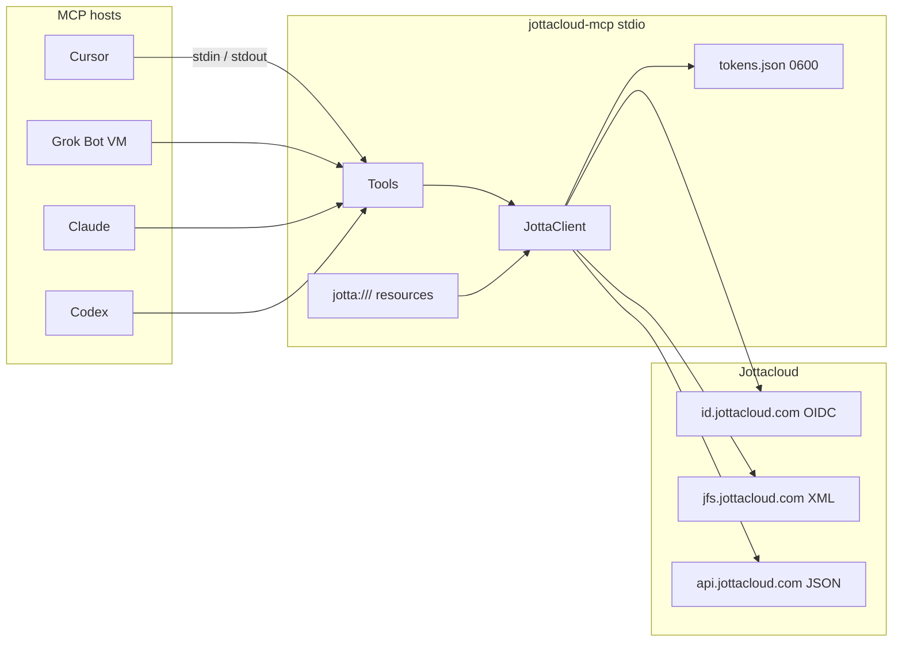
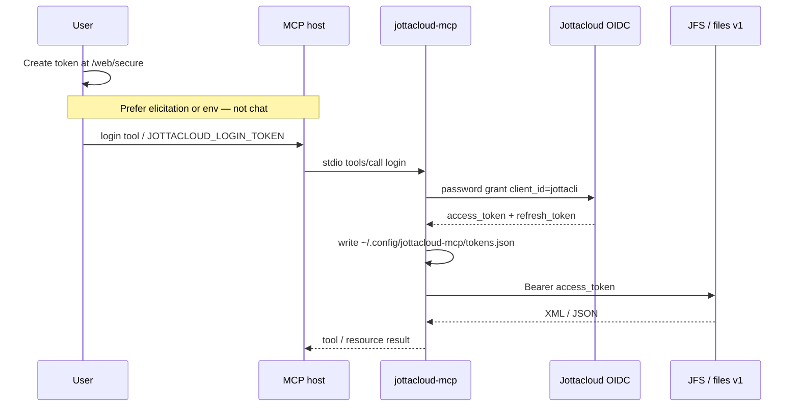
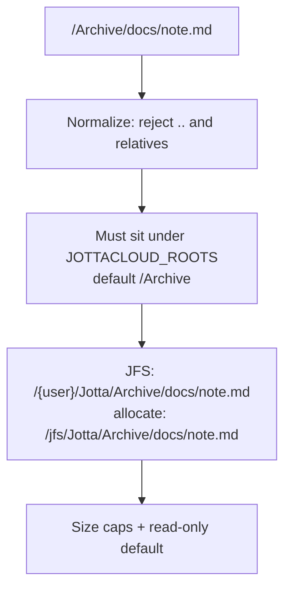

# jottacloud-mcp

**v0.1.0** — `@henrikogard/jottacloud-mcp` on npm.

Stdio [MCP](https://modelcontextprotocol.io) server so **Cursor**, **Grok Bot**, **Claude**, and **Codex** can read (and optionally write) [Jottacloud](https://www.jottacloud.com) files.

It is a local process: Cursor/Claude/Codex spawn it on your machine; Grok Bot runs the same `npx` command on its cloud VM. The default transport remains stdio. An optional **private, read-only HTTP service** and MCP Apps file browser are available from this source checkout; see [the ChatGPT integration guide](docs/chatgpt-integration.md). No service has been deployed by this change.

Jottacloud has no third-party OAuth app. Login is the same **personal login token** as `jotta-cli` / rclone.

**Author:** Henrik Øgård · **License:** [MIT](./LICENSE)

## Architecture

The server is a thin MCP adapter in front of Jottacloud’s unofficial JFS (XML) and `files/v1` (JSON) APIs. Hosts never talk to Jottacloud directly.



### Auth

The personal login token from [jottacloud.com/web/secure](https://www.jottacloud.com/web/secure) is a one-shot base64url JSON blob (`username`, `auth_token`, `well_known_link`). The server exchanges it for access + refresh tokens and stores only those.



Use the `login` tool (host elicitation) or `JOTTACLOUD_LOGIN_TOKEN`. Do not paste the token into chat transcripts.

### Path sandbox

Agent paths are mount-relative. They never include your Jottacloud username.



| Agent path | JFS URL |
| --- | --- |
| `/Archive/docs/note.md` | `https://jfs.jottacloud.com/jfs/{user}/Jotta/Archive/docs/note.md` |
| `jotta:///Archive/docs/note.md` | Same file, via MCP resources |

`/Trash` is **not** a default root. `list_trash` / `restore_file` use it explicitly so search and listing do not dump trash into ordinary results. Add Sync with `JOTTACLOUD_ROOTS=/Archive,/Sync`.

## Setup

```bash
npm install
npm run build
```

Node 20.19+ (Node 22 recommended).

1. Create a personal login token at [https://www.jottacloud.com/web/secure](https://www.jottacloud.com/web/secure).
2. Either leave it in `JOTTACLOUD_LOGIN_TOKEN` for the first MCP start, call the `login` tool, or exchange it once:

```bash
JOTTACLOUD_LOGIN_TOKEN='…' node dist/index.js --login
```

Refresh tokens are stored at `~/.config/jottacloud-mcp/tokens.json` (`0600`). Do not share that file. **One MCP process per store** — refresh-token rotation will kill the session if two processes race.

The personal login token is **one-shot**. After a successful exchange, the store is enough.

Default is **read-only**. Set `JOTTACLOUD_READ_ONLY=0` to enable write/mkdir/copy/move/delete/share.

## Cursor

Desktop Cursor: `~/.cursor/mcp.json` (or project `.cursor/mcp.json`):

```json
{
  "mcpServers": {
    "jottacloud": {
      "command": "npx",
      "args": ["-y", "@henrikogard/jottacloud-mcp"],
      "env": {
        "JOTTACLOUD_LOGIN_TOKEN": "paste-from-web-secure",
        "JOTTACLOUD_ROOTS": "/Archive",
        "JOTTACLOUD_READ_ONLY": "1"
      }
    }
  }
}
```

After `--login` you can omit `JOTTACLOUD_LOGIN_TOKEN`.

**Cursor Cloud Agents** do not read `~/.cursor/mcp.json`. Add the server in the MCP dropdown at [cursor.com/agents](https://cursor.com/agents).

## Grok Bot

Grok Bot cannot use your laptop’s `mcp.json`. Ask the bot in chat (say **custom server**):

> Add a custom MCP server called jottacloud that runs: npx -y @henrikogard/jottacloud-mcp
> Set env JOTTACLOUD_LOGIN_TOKEN to my personal login token, JOTTACLOUD_READ_ONLY=1, and JOTTACLOUD_ROOTS=/Archive.

Until publish, use a built path the bot can run, or `npx` from npm once published. Put the token on the **server env**, not in later chat.

On Grok’s cloud computer the token store is that VM’s home dir. For the durable workspace:

`JOTTACLOUD_TOKEN_STORE=/workspace/jottacloud-mcp-tokens.json`

Attach with `@jottacloud` in chat.

This is **not** grok.com → Connectors (that path needs a public HTTPS MCP).

## Claude and Codex

Claude Desktop: `~/Library/Application Support/Claude/claude_desktop_config.json` (same `mcpServers` JSON as Cursor). Fully quit Claude after edits.

Claude Code: `.mcp.json` or `~/.claude.json`.

Codex (`~/.codex/config.toml`):

```toml
[mcp_servers.jottacloud]
command = "npx"
args = ["-y", "@henrikogard/jottacloud-mcp"]

[mcp_servers.jottacloud.env]
JOTTACLOUD_LOGIN_TOKEN = "paste-from-web-secure"
JOTTACLOUD_ROOTS = "/Archive"
JOTTACLOUD_READ_ONLY = "1"
```

## Environment

| Variable | Role |
| --- | --- |
| `JOTTACLOUD_LOGIN_TOKEN` | One-shot personal login token (bootstrap) |
| `JOTTACLOUD_TOKEN_STORE` | Override token file path |
| `JOTTACLOUD_ROOTS` | Allowed path prefixes (default `/Archive`) |
| `JOTTACLOUD_READ_ONLY` | `1` (default) omits write tools; `0` enables them |
| `JOTTACLOUD_DEVICE` / `JOTTACLOUD_MOUNT` | Defaults `Jotta` / `Archive` |
| `JOTTACLOUD_LIVE_TEST` | `1` enables live API tests (not used in CI) |

## Tools and resources

Read (always):

| Tool | Role |
| --- | --- |
| `login` | Elicit / exchange a personal login token |
| `list_roots` | Configured roots + discovered mounts |
| `list_directory` | Folder listing with cursor pagination |
| `get_file_info` | Metadata only |
| `search_files` | `?mode=liststream` + local name filter; walk fallback |
| `read_file` | Capped text / base64; `head` / `tail` / `max_bytes` |
| `list_trash` | List `/Trash` without making it a general root |

Write (if `JOTTACLOUD_READ_ONLY=0`):

| Tool | Role |
| --- | --- |
| `write_file` | Create/overwrite (capped) |
| `create_directory` | `mkDir`, parents as needed |
| `copy_file` | `cp` / `cpDir` |
| `move_file` | `mv` / `mvDir` |
| `restore_file` | Move out of `/Trash` into an allowed root |
| `delete_file` | Soft-delete to trash; requires `confirm=true` |
| `create_share_link` / `revoke_share_link` | `enableShare` / `disableShare` |

**Resources:** `jotta:///{+path}` (for example `jotta:///Archive/docs/note.md`). Same size caps as `read_file`. The template is advertised; the whole account is not enumerated in `resources/list`.

Paths look like `/Archive/docs/note.md`.

## File browser and plugin packages

The same repo contains the server, React MCP App and shared `find-and-read` skill. `npm run build` generates a single-file UI plus standalone local plugin folders under `artifacts/plugins/claude` and `artifacts/plugins/openai`. The folders include a bundled Node server, the UI and skills; no npm install or unpublished package version is needed inside the installed plugin.

The browser lists configured roots, paginates folders, searches file names, previews bounded text and small PNG/JPEG/GIF/WebP images, and lets the user explicitly add a selected file to conversation context. PDF/Office text extraction, uploads, edits, composer mentions and multi-user hosting are not included. A preview alone does not add the file bytes to model context. Existing tools-only stdio use remains available.

See [ChatGPT setup and verification boundaries](docs/chatgpt-integration.md) for private OAuth, deployment prerequisites and local plugin testing.

## Development

```bash
npm run typecheck
npm run build
npm test
npm run test:ui
```

The UI tests use a synthetic MCP Apps host (`web/qa.html`) that is not included in the production bundle. The HTTP test exercises OAuth and MCP over localhost with synthetic files and never uses real account credentials.

Live Jottacloud tests stay off unless you opt in (needs a real token / store; skipped in CI):

```bash
JOTTACLOUD_LIVE_TEST=1 npm test
```

Protocol smoke (initialize + `tools/list`) runs in CI as a stand-in for MCP Inspector. For the GUI:

```bash
npx @modelcontextprotocol/inspector node dist/index.js
```

## Security

- Default root is `/Archive` only; `..` and paths outside the allow-list are rejected.
- Read-only by default; delete is trash-only and needs `confirm=true`.
- Tokens live in env or a `0600` file, never in tool arguments by design. Elicitation is the in-app login path.
- One process per token store (refresh rotation).
- Treat cloud file names and contents as untrusted (prompt injection).

## License

[MIT](./LICENSE) © 2026 Henrik Øgård
